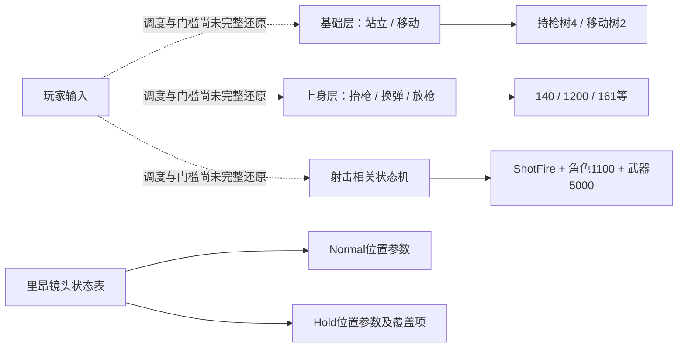
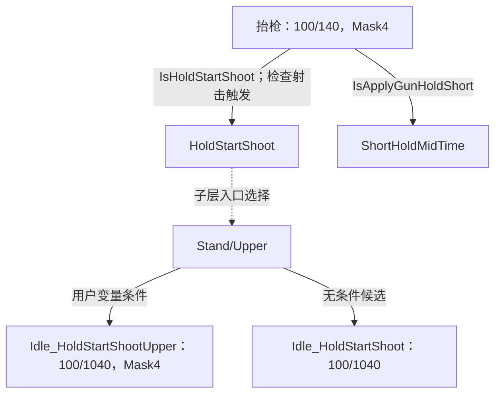
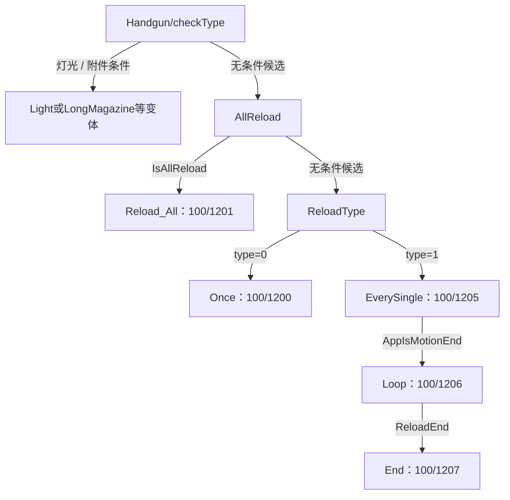

# 里昂第三人称手枪 3C 操作链拆解

版本：静态配置研究 v1，2026-11-04。Character=角色，Camera=镜头，Control=操控。本轮在已有动画资源研究上，继续追踪“输入相关配置 → 状态选择 → 角色/武器动作 → 镜头与结束条件”。尚未进行游戏内运行时记录，以下不提供未经测量的输入延迟、射速或取消窗口。

## 1. 先看结论

- 抬枪有通向 HoldStartShoot 的射击触发分支，后续站立分支使用1040片段。抬枪不应被理解为单纯播放140后才可能处理射击。
- 射击同时涉及角色1100、武器5000、ShotFire及SetWaitRefire。30帧的源动画不能直接用来计算射速。
- 基础手枪换弹走 Handgun/Once，使用1200；逐发装填有1205开始、1206循环和1207结束；All分支使用1201。
- 普通与持枪镜头分别引用 Normal/Hold 位置资源。Hold另有5个覆盖配置，基础位置和FOV存值不等于游戏最终镜头。
- 目前已能建立调用及条件关系；输入门槛、取消优先级和弹药事件准确时刻仍需游戏内记录。

## 2. 证据等级与图的读法

|等级|本报告如何使用|
|---|---|
|静态确认|文件中实际存在的字段、数值、引用或边|
|解释/推断|根据类名和连接关系解释用途，未验证引擎方法实现|
|待测量|按键到响应的延迟、取消窗口、弹量与镜头最终值等|

状态机有三类关系必须区分：父子节点表示“包含”，入口选择表示“进入某一分支”，状态转移才表示“从当前节点转到另一节点”。无条件项也不代表立刻或无视前置条件执行。完整边表 state_edges.csv 保留关系类型，不把它们画成一条固定的时间线。

## 3. 操作链总览

这张图表示职责与引用，不表示玩家必须按从左到右的固定顺序操作。角色动画、射击逻辑和镜头可以由不同系统同时更新。

### 3.1 移动与站立持枪

TPSBase 的 HoldIdle/Hold_Loop 调用 Bank10/Motion4，混合160、165、167；HoldMove/Hold_strafe 调用 Bank10/Motion2，组合120、122、124、126。MoveDir关联方向，MoveIntencity及HoldStairMoveSpeed参与速度控制。

两个父状态都存在启用的 AnimSlipReductionIK 配置，说明动作播放之外还配置了防滑相关修正；尚未验证实际求解算法。ClearInputState.InputBit=2也是存值，未映射其枚举，不将其直接叫作“清除移动键”。

**仍不能确定：** 输入方向坐标系、静止/移动的切换阈值、加减速曲线，以及实际移动由动画根运动还是角色移动逻辑驱动。

### 3.2 抬枪与抬枪期间射击

Q 的动作类原名为 HoldStartSootContinue，包含 MinContinueTime=1、MaxContinueTime=7。这里不修正类名拼写，也不把1和7说成“帧”或“秒”：类型字段没有证明单位、计时起点和具体实现。

ShortHoldMidTime 另有 RequestMotionNextNormalizedTime 的保留/应用配置。它提供“后续动作时间可能被接续”的线索，但还没有足够证据描述精确的时间重映射公式。

### 3.3 射击、重发和空枪

普通半自动路径：TPSAdd/root/Shot/SemiAuto/Normal/Handgun00H_1100_Shoot。

|位置|已确认配置|可以得出的结论|
|---|---|---|
|Shot父节点|SetWaitRefire；CustomMotionSpeedChange|存在重发等待与速度相关处理入口；具体时长未给出|
|Normal父节点|ShotFire；_FakeShot=false；_Timing=0|存在发射逻辑动作；0不是已知帧号|
|Normal父节点|PlayEquipGunMotion：Bank=-1、Motion=5000|武器自身动画有独立请求；-1保留为动态/特殊值，不猜固定Bank|
|1100叶节点|100/1100；UpdateShootEnd|角色射击片段和结束更新分别配置|
|1100→End|ConditionNodeWorkEnd|退出由节点工作结束条件控制，不能直接等同源片段末帧|
|Shot父节点|Battle_ShotBefore / Battle_ShotAfter，Timing=0/1|两类事件请求存在；枚举值不能当作事件时间轴坐标|
|DryShot父节点|DryShot、SetWaitRefire、ReserveReloadAction|空枪有独立处理及预留换弹请求；不等于已证明所有情况下都会自动换弹|

### 3.4 换弹：修正后的实际手枪路径

**对旧报告的更正：** 名为 Handgun00H_1200_Reload、ID为360106824的节点，实际位于 Rifle 分支。不能只根据节点名称把它当成手枪路径。基础手枪路径是 root/Weapon/Reload/Handgun/Once，其动作类是 PlayerSubActionEnd（CheckMotionEnd=true），并非借用 Rifle 节点到 ActionEnd 的边。

Reload父节点配置Mask2及Reload动作；Handgun父节点启用IkAlignHand。Once、Reload_All和End使用CheckMotionEnd=true的PlayerSubActionEnd。各播放节点还请求武器动画。

逐发路径的节点名称与1205/1206/1207结构支持“开始—循环—结束”的解释，但ReloadEnd内部到底检测弹量、输入还是组合条件，还未还原。不能由这个类名判断准确的取消条件。长弹匣、灯光等分支也不能全部合并成1200一种换弹。

PreAdd关联仍按角色配置中的Bank偏移+2000、Motion偏移0及Mask11解释；本轮没有把未经验证的补偿混合写成最终游戏姿态。

### 3.5 放下枪

HoldEnd父节点包含UpdateHoldEnd；站立子节点Handgun00H_0161_Hold_End播放100/161并检查动作结束。另有蹲姿等变体。尚未确认松开瞄准如何从外部调度器请求该状态，也未确认镜头、射击与上身状态退出的相对次序。

## 4. Control：输入相关参数不等于输入延迟

来自里昂 cp_a000configuration.user.3 的 PlayerInputConfiguration（instance307，启用）：

|字段|原值|解释边界|
|---|---:|---|
|_DisableSwitchHoldInputTime|0.3|切换持枪输入相关限制；未确认计时上下文|
|_ContinueHoldStartTime|0.25|持枪开始延续相关设置；不能直接称为抬枪耗时|
|_DisableInputReloadTime|0.3|换弹输入限制相关设置；不等于按键后固定等0.3秒|
|_DisableQuickHealTime|2.5|快速治疗相关设置，仅保留为上下文|

这些是文件中的数值。Time字段的单位、起算事件、是否受其他设置覆盖仍需方法实现或运行时记录确认。

角色转向配置中默认 _TPSHoldOffsetDeg=-6，部分武器ID有-9或-7覆盖；这是角色持枪角度偏移，不是相机肩侧位置。PlayerRotateCorrectorBySpeed中另有StartAccelTime=0.08、StartCompleteTime=0.19、DelayChaseTime=0.5，不能脱离启用上下文把它们作为通用角色转身时间。

## 5. Camera：已连接到里昂状态表的基础镜头参数

引用链已验证：cp_a000tpscamerasettinguserdata → Normal / Hold → 各自Position、FOV、Collision资源。两种基础动作均引用TPS_Default旋转配置；Hold另含5组覆盖项。

|基础参数|Normal|Hold|
|---|---|---|
|跟随关节 _JointName|root|root|
|位置偏移 _Offset|<0.5, 1.47, 0>|<0.4, 1.5, 0.1>|
|_GazeDistance|1.7|1.1|
|_IsHipLocalPosDiff|false|true|
|FOV _Type|0|0|
|FOV _FOVTemplateType|0|1|
|FOV _FOVRate|1|1|
|FOV _FOVOverride|63|63|

这些是基础资源存值，不是已经测出的最终相机世界位置或视野。位置受坐标基准、曲线、跟随阻尼、碰撞及覆盖项影响。两个文件都存有63，也不能得出“瞄准不改变FOV”：TemplateType不同，_Type及模板的选择语义尚未验证。

通俗解释：角色进入某个镜头状态后，系统先取一份基础方案，再按具体情境使用覆盖配置；网页目前的轨道观察相机是研究工具镜头，没有冒充这套游戏镜头。

## 6. 时间线：已有顺序证据与仍未知的时间

|阶段|源片段|源帧数/采样率|时间上的已知与未知|
|---|---|---|---|
|抬枪|140|30 / 60|配置存在射击触发分支；输入到进入该分支的延迟未知|
|持枪|160|307 / 60|循环素材；不代表玩家只能持枪5.12秒|
|射击|1100|30 / 60|发射逻辑与动作分开；子弹生成帧未知|
|换弹|1200|312 / 60|结束检查存在；弹量更新时间和可取消窗口未知|
|放下枪|161|109 / 60|动作结束检查存在；与镜头退出的先后关系未知|

源帧数除采样率仅给素材名义时长，不包括速度修正、时间接续、提前退出和事件条件。证据页展示这些片段并能跳到播放器，但不会用伪造的事件标记填满时间轴。

## 7. 打断关系与待验证清单

|问题|当前证据|状态|
|---|---|---|
|抬枪期间是否存在射击处理分支|140→HoldStartShoot及1040|静态确认有分支；最早可射时刻待测|
|射击能否连续重发|SetWaitRefire入口|等待规则、射速、输入排队待测|
|移动中是否能保持瞄准|HoldMove基础树与独立上身层|结构支持；最终调度/速度待测|
|换弹中能否松开瞄准/切枪/移动/受击退出|尚未还原外部调度与优先级|待测；不能把未找到边解释为禁止|
|换弹被打断后保留多少弹药|尚未定位弹量事件|待测|
|空枪是否自动换弹|ReserveReloadAction|存在请求入口；触发条件待测|
|瞄准靠墙会怎样|Hold碰撞配置、PushbackIK入口|最终镜头和姿势待测|

runtime_test_plan.csv提供10组实验，结果均为“未测量”。每组分别记录输入时间、状态时间、玩法事件时间和画面时间。录像应固定武器/配件/视角/帧率条件；同一试验重复，保留原始记录。只有录像时只能报告画面可观察结果；准确的内部状态需要运行时日志配合。本轮没有向游戏安装任何注入工具。

## 8. 可复查交付物与验证

- 交互证据页：docs/player/3c.html，点击阶段查看证据和待测项，可打开对应原始动画。
- evidence.json：5个阶段对应的完整节点、镜头字段和研究说明。
- state_edges.csv：3个TPS状态机共3836条关系，分开保存包含/入口选择/状态转移等类型，目标均可解析。
- parameters.csv：输入、转向和普通/持枪镜头的关键原值。
- camera/parse_log.json：279个有效镜头资源均解析成功；其中94个路径在patch004有覆盖版本，按最高补丁号选取。覆盖优先级仍未由运行时日志验证。
- runtime_test_plan.csv：10组测量场景，未填造实际结果。
- validation.json：静态检查汇总；RuntimeMeasurements=0。

复现脚本：scripts/3c_index.cjs、scripts/CameraAudit/Program.cs、scripts/3c_build.cjs。此研究建立在先前310个motlist与6个motpack样本上，不代表游戏全部输入或动作逻辑已经还原。
