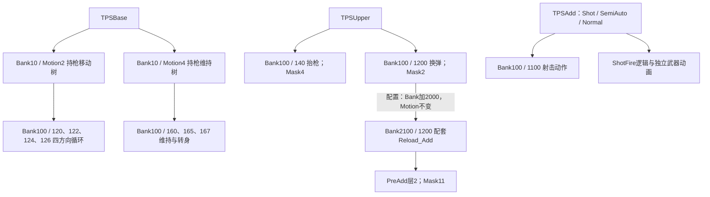

# ch0100（里昂）手枪动画拆分研究

日期：2026-11-04。范围：本机安装包的静态资源、动作树、状态机与角色配置；未进行游戏内逐帧回放。研究输出位于 E:/CodexPepo/RE_Research，未修改游戏资源。

## 1. 角色身份：ch0100 对应里昂

证据链：`cp_a000configuration.user.3` 的 `_LipSyncConfiguration._UseAssetTags` 为 `ch0100`，声音 `_SpeakerID` 也为 `ch0100`；`cp_a000montagepresetdata.user.3` 引用 `Character/ch/ch01/0100/ch0100_MontageData_*.user`。

外部交叉验证：RExtender 作者明确说明 `Cp_A000Updater` 对应 Leon，`Cp_A100Updater` 对应 Grace。[作者说明](https://www.nexusmods.com/residentevilrequiem/mods/2279?tab=description)

因此本次研究的 ch0100 主体资源可高置信度认定为里昂。cp_a000 同时引用其他外观编号，不能把所有 ch01xx 都理解为不同角色。

## 2. 拆分方式：动作片段、混合树、身体分层与武器变体

手枪行为由 TPSBase（移动和持枪基础姿态）、TPSUpper（抬枪、换弹等上身行为）、TPSAdd（射击相关行为）及 PreAdd 配置共同组织。源动作与运行时作用范围是两个概念：射击及换弹源 MOT 各含 67 条骨骼轨道，包括髋部和腿部，最终作用范围需要结合关节遮罩理解。

下面连线表示调用或配置关系，不表示固定的时间顺序。



### 动作树怎样组合移动与瞄准

- `Hold_strafe` 调用树 2：前、后、左、右四个 MotionNode 经 OctSyncBlendNode 混合，再进入 PlaySpeedNode。变量 `MoveDir` 控制方向；`MoveIntencity`（资源原拼写）经过范围归一化并与 `HoldStairMoveSpeed` 参与计算后控制速度。此处不臆测 Calculate 的 Operation 枚举运算含义。
- `Hold_Loop` 调用树 4：160 持枪循环与 165/167 左右转身循环混合，关联 `WheelBlendRate`、`WheelSpeed`。
- 上身 `HoldDefault / Normal` 调用树 5000，实际为含 JointMask9000 的 BasePoseNode。不能仅凭状态名称认定它重复播放 160。

### Bank 的定位必须包含 Type

|Type|BankID|所引用资源|
|---|---:|---|
|0|10|ch0100_MotionTree|
|1|0 / 2000|Handgun00M / Handgun00M_Add|
|1|100 / 2100|Handgun00H / Handgun00H_Add|
|0|100 / 2100|GeneralH / GeneralH_Add|
|65537、131073 等|100|Handgun00HverB、verC 等变体|

相同 MotionID 能在不同武器组或变体中复用；只用 BankID 或文件名猜调用对象会产生歧义。下表的手枪来源对应所选 Handgun00 组。

## 3. 手枪片段明细

frameCount / FPS 是源资源字段。运行时还受速度、混合、条件切换影响，不能直接当成游戏中持续时长。

|用途|Bank / Motion|源动作名|frameCount / FPS|调用入口与应用范围|
|---|---|---|---|---|
|瞄准移动-前|100 / 120|ch0100_Handgun00H_0120_Strafe_F_Loop|96 / 60|TPSBase → Bank10/Motion2；动作树节点 Mask0|
|瞄准移动-左|100 / 122|ch0100_Handgun00H_0122_Strafe_L_Loop|84 / 60|TPSBase → Bank10/Motion2；动作树节点 Mask0|
|瞄准移动-后|100 / 124|ch0100_Handgun00H_0124_Strafe_B_Loop|76 / 60|TPSBase → Bank10/Motion2；动作树节点 Mask0|
|瞄准移动-右|100 / 126|ch0100_Handgun00H_0126_Strafe_R_Loop|83 / 60|TPSBase → Bank10/Motion2；动作树节点 Mask0|
|抬枪进入|100 / 140|ch0100_Handgun00H_0140_Hold_Start_L0|30 / 60|TPSUpper → Wp0000H_140_Hold_Start_L0；Mask4：53个关节|
|持枪维持|100 / 160|ch0100_Handgun00H_0160_Hold_Loop|307 / 60|TPSBase → Bank10/Motion4；与165、167混合|
|持枪向左转|100 / 165|ch0100_Handgun00H_0165_Wheel_L_Loop|77 / 60|TPSBase → Bank10/Motion4；WheelBlendRate / WheelSpeed|
|持枪向右转|100 / 167|ch0100_Handgun00H_0167_Wheel_R_Loop|77 / 60|TPSBase → Bank10/Motion4；WheelBlendRate / WheelSpeed|
|放下枪|100 / 161|ch0100_Handgun00H_0161_Hold_End|109 / 60|TPSUpper → Hold_End分支；具体分支控制|
|单次射击|100 / 1100|ch0100_Handgun00H_1100_Shoot|30 / 60|TPSAdd → Shot/SemiAuto/Normal；附加状态机；精确层混合数学未复演|
|常规换弹主体|100 / 1200|ch0100_Handgun00H_1200_Reload|312 / 60|TPSUpper → Handgun00H_1200_Reload；Reload父节点 AutoSetJointMask2|
|常规换弹躯干补偿|2100 / 1200|ch0100_Handgun00H_1200_Reload_Add|312 / 60|UpperBodyPreAddConfiguration：层3 → 层2；Mask11：Hip 0.3，其余六关节0.5|
|另一换弹变体|100 / 1201|ch0100_Handgun00H_1201_Reload_All|194 / 60|TPSUpper → Handgun00H_1201_Reload_All；与1200分开制作，不强猜All枚举语义|
|换弹变体补偿|2100 / 1201|ch0100_Handgun00H_1201_Reload_All_Add|194 / 60|Bank偏移+2000 / Motion偏移0；Mask11|

## 4. 遮罩与换弹补偿：已找到显式配置

`cp_a000configuration` 的 `_UpperBodyPreAddConfiguration`：Enabled=true、UpperBodyLayerNo=3、PreAddLayerNo=2，引用 PlayerCommonPreAddSetting。

该设置的 DefaultBankIdOffset=2000、DefaultMotionIdOffset=0、DefaultJointMaskID=11。因此上身 `100/1200` 对应配套 `2100/1200`；两段均为 312 帧、60 FPS。1201 与其 Add 也同为 194 帧、60 FPS。配置支持成对组织主体动作与身体补偿的结论。

|Mask|关节数量|本次用途与范围|
|---|---:|---|
|2|51|Reload 父节点 AutoSetJointMask；包含手臂、手指、颈头及武器/目标等，不含脊柱及腿部；有一个骨名尚未解析|
|4|53|抬枪节点 SetJointMask；包含 Spine_0/1/2、手臂、手指及头部，不含腿部|
|11|7|PreAdd：Hip 权重0.3；Spine_0/1/2、Neck_0/1、Head_0 各0.5|

这里的权重为配置存值，不等于屏幕上最终混合权重。原始 mask 数值仍保留在 JSON；尚未完整验证每个标志位的引擎语义。TPSAdd 的名称和调用关系也不足以单独证明其精确叠加公式。

## 5. 状态切换与事件：已经定位到哪些内容

**抬枪**：`Wp0000H_140_Hold_Start_L0` 播放 `100/140` 并设置 Mask4；存在 CheckMotionEnd 检查。同时可按 `IsHoldStartShoot`（检查射击触发）转入 HoldStartShoot，也可按 `IsApplyGunHoldShort` 进入 ShortHoldMidTime。实际流程包含提前分支。

**射击**：TPSAdd 中 `Shot → SemiAuto → Normal → Handgun00H_1100_Shoot` 调用射击动作。Normal 父节点包含 `app.ShotFire`，并通过 `app.PlayEquipGunMotion` 请求武器自身 MotionID5000；上层还请求 Battle_ShotBefore / Battle_ShotAfter。动作退出关联 UpdateShootEnd 与 ConditionNodeWorkEnd。已证实射击动画、射击逻辑、武器动画分别受控；尚未确定子弹生成的精确帧。

**换弹**：Reload 父节点设置 Mask2；Handgun 分支通过 ReloadType 条件选择 Once / EverySingle，所见枚举值为0/1。1200 节点调用角色动画及武器动画，按 AppIsMotionEnd 转向 ActionEnd。1201 名称含 Reload_All，但本报告不把命名或枚举强行等同于空仓/非空仓。弹匣插入、弹量更新的准确事件帧仍待运行时验证。

## 6. 复用与外部动作包规则

解析器按本地片段、外部 motpack 引用及 base 列表中相同 `(MotionID, Switch)` 逐级解析，并记录来源。外部槽位需检查 ReferenceSelector：本样本中 selector=0 且索引非负可与指定 motpack 对齐；selector=255 的正索引不能直接当成 motpack 下标。

|列表|槽位|本地|继承|外部包|未解析|
|---|---:|---:|---:|---:|---:|
|Handgun00H|102|102|0|0|0|
|Handgun00M|274|247|27|0|0|
|Handgun30H|102|0|70|32|0|

例如 Handgun30H 继承 Handgun00H，并引用 Handgun30H_Common motpack；1200 的外部索引0落到 Handgun30H_1200_Reload。这说明武器变体可复用基础动作，仅替换差异动作。该 selector 规则来自结构交叉检查，不能视作全部 RE Engine 版本的正式格式规范。

## 7. 验证范围、证据与复现

- 有效样本862个资源：按相同资源路径取最高补丁编号建立静态视图，未通过运行时加载日志确认优先级。
- 310个 motlist、6个 motpack，累计23717个槽位；槽位包含继承和重复引用，不能当作独立动画数。
- 536个 user / motfsm2 输入全部解析成功；9个状态机的节点与转场字段通过两套解析路径交叉检查；112棵动作树完成类型化解析。这些检查确认解析一致性，不能代替引擎回放。
- 全部样本仍有106个特殊引用槽位未解析，明确保留未解析状态。所选 Handgun00H / Handgun00M 解析结果无未解析槽位。
- 部分 RE9 转场字段含义仍不确定；本报告没有据此宣称精确过渡时长、完整根运动规则或运行时混合公式。

关键文件（均在本报告目录）：

- `handgun_production_breakdown.csv`：14项片段、源帧数、调用入口和源文件。
- `handgun_evidence.json`：选中的状态机节点、父子层级、动作树、角色与 PreAdd 配置、骨骼遮罩。
- `all_resolved.csv` / `external_pack_mapping.csv`：槽位解析和外部包映射。
- `effective_files.csv` / `evidence_manifest.csv`：补丁来源与关键证据 SHA256。
- `validation.csv` / `full_parse_log.json`：交叉检查及解析记录。
- `full/` 与 `parsed/`：类型化结果和独立二进制解析结果。

脚本位于 `E:/CodexPepo/RE_Research/scripts`。核心流程为 ResearchPhase2.cs 选择性提取 → phase2_strings.ps1 有效版本 → deep_audit.ps1 二进制结构 → FullAudit/FullAudit.csproj 类型化解析 → phase2_finalize.ps1 解析引用 → phase2_deliverables.ps1 汇总。旧 handgun_resolved.csv 为早期继承结果，最终判断以 all_resolved.csv 为准。

工具来源：[REE.PAK.Tool](https://github.com/Ekey/REE.PAK.Tool)、[ReExtractor](https://github.com/PieceMetal/ReExtractor)；本地 RE-Engine-Lib 做了 .NET8 编译兼容调整，补丁保存在 `reelib_net8_compat.patch`。资源类型模板来自 REasy 与 REE-Lib-Resources，已存入 references 目录。

下一步最有价值的验证是记录一次游戏内里昂手枪抬枪、移动、射击、换弹时的 Bank/Type/Motion、状态与层权重，将实际切换和事件帧对回本报告。当前产物已可用于了解素材拆分和制作粒度；还不能替代逐帧动画播放或导出结果。

## 8. 角色骨骼与动画数量详表（2026-11-04 补充）

### 8.1 统计范围与“动画数量”的口径

本节统计已有的 ch0100 有效版本样本：310 个 motlist、6 个 motpack。未把旧补丁副本叠加计算；仍不包含尚未提取、未命中路径清单或其他角色编号下的全部资源，所以不能称作“里昂在整个游戏中的动画总数”。

|项目|数量|含义|
|---|---|---|
|动作列表（motlist）|310|包含片段、继承项、外部引用和动作树|
|外部动作包（motpack）|6|独立存放可被列表引用的片段|
|列表动作槽位|23717|每条列表的槽位之和，含重复引用|
|本地有载荷的槽位|6406|Route=local；可能是 MOT 或动作树|
|经 base 继承的槽位|15397|含继承后再落到外部包的情况|
|直接外部包引用槽位|1808|仅直接 pack 路径，不含上一行|
|未解析槽位|106|特殊引用尚未解释|
|物理 MOT 片段|6185|按“有效源文件路径＋载荷偏移”去重|
|动作树载荷|122|同一物理偏移仅计一次；不作为骨骼动画|
|不同 MOT 名称|5947|仅名称去重，不能当作内容去重|

**推荐数量表述：本次已解析样本包含 6185 个物理 MOT 片段、122 个动作树载荷；它们通过 23717 个列表槽位被组织和复用。** 物理片段计数包含这 6 个 motpack 中已解析的载荷，无论其是否被当前列表引用；不同文件中即使动作内容完全相同，仍计为不同物理片段。没有执行逐轨道内容哈希或视觉相似度去重。动作树122个由主 MotionTree 的112个、MotionTree_Add 的5个和面部列表内的5个组成；前文112棵类型化动作树特指主 MotionTree。

### 8.2 角色骨骼数量：动作骨架与模型骨架

当前手枪主片段（如持枪160）包含 **69 个骨骼定义、67 条骨骼动画轨道**。配套换弹 Add 片段包含 **67 个骨骼定义、67 条轨道**。这几个数字只描述所选动作骨架，不是完整角色渲染骨架的固定上限。

|手枪主动作骨骼分类|数量|
|---|---|
|手指 / 手掌|32|
|目标 / 武器挂点 / 相机 / IK辅助|11|
|腿 / 足|10|
|手臂 / 锁骨|8|
|髋 / 脊柱 / 颈 / 头|7|
|根节点|1|

上表按69骨骼参考骨架的骨骼名互斥分类；手掌单列在手指组，Arm_Hand 作为手臂链末端计入手臂组。辅助类别含武器挂点、相机、地面和 IK 目标。

网页灰模使用6个分件，各分件骨架独立保存，包含身体、面部、衣物辅助骨：

|灰模分件|骨骼定义|变形骨重映射表|当前LOD实际加权骨|匹配持枪动画轨道的骨|
|---|---|---|---|---|
|右臂 / 手套|125|60|60|28|
|左臂 / 手套|129|60|60|28|
|头部 / 面部|285|252|251|12|
|头发|69|52|52|8|
|上衣|157|64|64|15|
|裤鞋 / 腰部附件|105|50|50|13|

6个分件的骨骼定义直接相加为 870，按名称合并后为 **710 个骨骼名**。后一数字只是这套灰模装配的名称并集：分件共享大量身体骨，且同名并不保证所有绑定参数相同，不能将它宣称为引擎运行时的完整角色骨骼数。实际加权骨按当前 LOD2、已导出的子网格计算；头部透明壳层等被省略。模型分件路径和逐项数量见 model_bone_counts.csv。

全部物理 MOT 片段的骨骼头数量分布（全部18种）如下；BoneCount=0 表示该载荷头未给出骨骼数量，不能据此判断动画没有轨道：

|MOT BoneCount|片段数|
|---|---|
|76|3518|
|69|946|
|73|796|
|70|206|
|75|181|
|78|162|
|77|126|
|591|54|
|67|42|
|85|34|
|72|32|
|79|26|
|463|23|
|63|16|
|71|16|
|65|3|
|82|3|
|74|1|

轨道数量分布（前10项）：

|每片段骨骼轨道数|片段数|
|---|---|
|67|5400|
|70|209|
|69|171|
|75|145|
|68|91|
|357|54|
|72|31|
|66|27|
|229|22|
|63|17|

### 8.3 按资源家族分类

以下按所属文件名分类，互斥且可合计。片段归属其实际存放的源文件；槽位归属发起引用的列表，因此继承通用动作不会增加武器组的物理片段数。名称中的 Machinegun 保留为“自动枪械”资源组，不强行等同于某一种现实枪械分类。

|资源类别|motlist数|motpack数|列表槽位|物理MOT|动作树|未解析槽位|
|---|---|---|---|---|---|---|
|手枪 / Handgun|60|2|4566|1182|0|6|
|自动枪械 / Machinegun|51|0|4723|1088|0|0|
|霰弹枪 / Shotgun|49|1|3723|1080|0|44|
|步枪 / Rifle|34|0|3190|639|0|6|
|通用 / General|10|0|844|447|0|3|
|左轮 / Revolver|44|3|3423|304|0|19|
|火箭筒 / RocketLauncher|7|0|527|298|0|0|
|其他 / Other|8|0|911|227|0|28|
|受击 / Damage|6|0|349|211|0|0|
|摩托 / Bike|2|0|157|154|0|0|
|斧 / Axe|4|0|254|138|0|0|
|机关交互 / Gimmick|3|0|122|110|0|0|
|面部 / Face|8|0|82|77|5|0|
|攻击 / Attack|4|0|165|66|0|0|
|电锯 / Chainsaw|8|0|394|50|0|0|
|投掷物 / Grenade|4|0|81|48|0|0|
|情绪动作 / Emote|3|0|56|33|0|0|
|拍照手势 / Photo|1|0|26|26|0|0|
|死亡 / Dead|2|0|7|7|0|0|
|动作树 / MotionTree|2|0|117|0|117|0|

合计：310 个列表、6 个外部包、23717 个列表槽位、6185 个物理 MOT、122 个动作树载荷。

### 8.4 按动作用途分类（基于名称的研究标签）

此表对物理 MOT 片段逐一打一个用途标签，**属于名称规则推断，不是游戏官方分类，也未逐条播放确认**。顺序为面部 → 换弹 → 射击 → 持枪瞄准 → 移动基础 → 受击 → 死亡 → 攻防 → 交互 → 装备 → 情绪 → 其他；先命中者优先。例如同时包含 Hold 和移动词的名称被归入持枪瞄准。详细正则和每片段结果均保存，避免用名称强猜所有片段。

|推断用途|物理片段数|
|---|---|
|移动 / 转向 / 基础姿态|2556|
|持枪 / 瞄准|1211|
|射击 / 开火|842|
|其他 / 名称不足以判定|513|
|换弹|299|
|交互 / 越障|225|
|受击 / 反应|198|
|装备 / 切换|138|
|攻击 / 防御|96|
|面部表情 / 口型|77|
|情绪 / 拍照|23|
|死亡|7|

“其他 / 名称不足以判定”保留原样，未为了凑分类而强行分配。上述各项合计 6185，可与物理 MOT 总数核对。

### 8.5 附加、视角和手枪基准库

另有两个可重叠标签：源文件名含 _add 的物理片段 **146** 个；源文件名含 fps 的物理片段 **1026** 个。它们分别表示命名上的附加组与第一人称变体组，不能与上面的资源类别或用途数量相加，也不能仅凭 _add 推定具体混合数学。

Handgun00H 基准列表的102个槽位对应 99 个物理 MOT。3组复用同一载荷的编号为：160 / 6001（Hold_Loop）、1110 / 1131（Shoot_Dotsight）、1203 / 1403（原名 Chanber_Check）。因此不能直接将102个槽位写成102条独立片段。按同一套用途规则得到：

|用途|Handgun00H片段数|
|---|---|
|持枪 / 瞄准|38|
|移动 / 转向 / 基础姿态|20|
|射击 / 开火|18|
|换弹|10|
|其他 / 名称不足以判定|9|
|装备 / 切换|4|

网页只选取其中一部分及配套 Add，共14条：四方向移动4条、抬枪1条、持枪循环1条、左右转身2条、放下枪1条、射击1条、换弹主体2条、换弹补偿2条。该14条是演示集，不是手枪全部动画。

源FPS分布：60 FPS：6185 个。FPS是资源采样率，不是渲染帧率；片段时长和重复循环不能直接加总成游戏表演时长。

### 8.6 可复现统计产物

- animation_physical_inventory.csv：每个物理片段的源路径、偏移、名称、分类、帧数、FPS、骨骼头数量与轨道数量。
- animation_category_counts.csv：资源家族数量及本地／继承／外部／未解析槽位。
- animation_action_counts.csv：名称规则用途分类数量。
- animation_container_counts.csv：316个容器逐文件统计。
- model_bone_counts.csv：6个灰模分件骨骼统计。
- detailed_statistics.json：完整汇总与骨骼／轨道数量分布。

骨骼统计输入保存在 bone_statistics_source.json，由 scripts/BoneStatistics/Program.cs 直接读取保留的 Mesh 与 MOT 样本生成，不依赖网页资产目录。复现命令：在 E:/CodexPepo/RE_Research 运行 `node scripts/detailed_statistics.cjs`。脚本检查分类合计、槽位路线合计和已有310列表/23717槽位基准；重跑会替换本节，保留前文研究结论。

## 9. 术语解释：从“模型怎样动起来”理解本报告

本节面向没有动画制作或引擎开发经验的读者。模型决定“长什么样”，骨骼决定“哪里能动”，动画轨道记录“怎样动”；motlist 组织动作，motpack 存放可被引用的动作，动作树负责组合动作。“动作槽位”和“物理 MOT 片段”是本报告为统计清楚使用的称呼，不是游戏界面术语。

### 9.1 motlist：动作目录兼收纳册

可以把 motlist 理解成一本动作目录兼收纳册。例如 Handgun00H.motlist 组织一组手枪相关动作：

|动作编号|对应内容|
|---|---|
|140|抬枪|
|160|持枪循环|
|1100|射击|
|1200|换弹|

它不仅列出名字，还告诉系统“这个动作的数据在哪里、应该如何找到”。动作数据可以直接放在当前 motlist 里，也可以借用另一份 motlist 的动作，或者指向外部 motpack。

因此，一个 motlist 文件不等于一条动画，也不一定实际存有它所列出的全部动画数据。

### 9.2 motpack：外置动作仓库

motpack 可以理解成外置动作仓库，里面存放实际动作片段，供 motlist 引用。motlist 是组织和查找入口，motpack 是一种外部存放方式。

这次发现，某些手枪变体借用基础手枪的大部分动作，把自己独有的换弹等动作放进 motpack，再在 motlist 中指出要使用仓库中的哪一段。

例如 Handgun30H 有102个动作槽位，其中70个继承基础列表的动作，32个引用外部包。几把枪如果移动和持枪方式相同，就可以复用相应动作，只为有差异的部分制作新片段。

motlist 本身也能存实际动画；并不是所有动画都必须放进 motpack。

### 9.3 动作槽位：目录中的一个查找入口

动作槽位就是 motlist 目录中的一个条目。可以把它想成通讯录中的一行：它提供一个查找入口，但不保证对应一份独立的数据。

报告中几种槽位类型，是按“查找动作的路径”划分的：

|槽位类型|数据如何找到|类比|
|---|---|---|
|本地|数据就在当前 motlist 内|本册直接收录|
|继承|当前列表借用基础列表的对应动作|请看基础册同编号条目|
|外部包|指向 motpack 中的动作|请取仓库第几号内容|
|未解析|存在条目，但引用方式尚未解释清楚|有索引，暂时没读懂|

这些类型描述数据在哪里，不描述动作做什么。射击、换弹和移动都可能采用其中某一种存放方式。“未解析”也不表示游戏无法播放，只表示研究工具尚未还原这种查找关系。

继承可以有多层：当前列表继承基础列表，基础列表又引用外部包。本报告把这种情况计入“继承”，避免在槽位统计中重复计数。

本地槽位还可能装的是动作树，而不是普通 MOT 片段。所以“本地槽位数”也不能直接叫作“骨骼动画数”。这里的统计分类不直接等同于二进制文件中名为 Type 的原始字段。

### 9.4 物理 MOT 片段：文件里实际保存的一份动画

这里的“物理”指文件里实际存着的数据，与碰撞、布料或物理模拟没有关系。更通俗的叫法是“实际存储的 MOT 动画片段”。

MOT 是存放骨骼动画的资源格式。一段 MOT 通常记录动作名称、帧数、采样率，以及各骨骼随时间变化的数据。

本报告的计数规则是：**同一个有效源文件、同一个数据位置，只算一份物理片段。**

例如手枪库中，编号160指向持枪循环，编号6001也指向同一份持枪循环数据。因此这里是两个槽位、一个物理 MOT 片段。Handgun00H 中还有另外两组相同情况，所以102个槽位实际对应99个物理片段。

这种统计还不是动画内容完全去重。如果两个不同文件各自保存了一份内容完全相同的动作，仍会计为两个物理片段。我们尚未逐条比较所有关键帧内容或画面相似度。

### 9.5 动作树载荷：一份组合动作的规则数据

“载荷”是程序领域的说法，意思是条目里实际存储的内容。“动作树载荷”可以直接理解为“一份动作树数据”。

动作树是一套组合动画的规则。例如已经有向前、向后、向左、向右移动四段动画，玩家往斜前方走时，动作树可以按照方向输入混合已有片段，并按照移动强度调整播放速度。

|内容|主要记录什么|
|---|---|
|MOT 动画片段|骨骼在不同时间的位置、旋转等变化|
|动作树|使用哪些动作、如何混合、哪些输入控制混合或速度|

动作树也可能只是很简单的姿态引用，不一定都包含复杂混合。因此报告把6185个 MOT 片段与122个动作树载荷分开统计，不能直接把两者相加称为6307条普通动画。

### 9.6 骨骼定义与骨骼动画轨道：结构图与运动记录

**骨骼定义像木偶的关节结构图；动画轨道像某个关节随时间运动的记录。**

骨骼定义告诉我们：这根骨叫什么、连接在哪根父骨下面、参考位置和朝向是什么。例如：

```text
肩部
└─ 上臂
   └─ 前臂
      └─ 手
         └─ 手指
```

骨骼动画轨道则记录这根骨在不同时间怎样变化。例如第0帧前臂朝向哪里、第10帧转到哪里、第20帧又转到哪里。实际文件往往只保存部分关键时刻，中间姿态由播放器通过插值计算。

一条骨骼轨道还可以包含几个通道：

|通道|控制内容|
|---|---|
|平移|骨骼位置如何变化|
|旋转|骨骼朝向如何变化|
|缩放|骨骼尺寸如何变化|

本报告的“67条骨骼动画轨道”指67个骨骼轨道条目，不是把平移、旋转和缩放分别算成三条。

“69个骨骼定义、67条轨道”并不矛盾。一个动作不必给每根骨提供独立的变化记录；没有轨道的骨可以保持参考状态，并跟随父骨运动。例如上臂抬起时，前臂即使没有单独改变角度，也会跟着整条手臂移动。

因此，没有独立轨道不等于画面里完全不动。骨骼定义数量描述结构规模，轨道数量描述这一段动作直接记录了多少骨骼的变化。

### 9.7 为什么灰模分件的骨骼定义数很高？

模型骨架需要让表面自然变形，通常比一段身体动作直接控制的结构更细。例如头部模型包含285个骨骼定义，其中有大量面部细分结构；持枪动作只需要让头颈随身体运动，不必同时为每根面部骨制作表情。

模型还可能包含手指细分骨、衣物和装备辅助骨、头发辅助骨、帮助关节周围表面变形的骨，以及维持父子关系但不直接影响模型表面的骨。

每个模型分件还可以保存自己的骨架结构。头部、上衣、手臂里可能都包含同名的身体骨，因此不能把各分件骨骼数相加后，当作角色独立关节的数量。报告中的710是这套六分件灰模按名称合并后的骨骼名数量，不是已确认的引擎运行时角色总骨骼数。

“灰模”只表示暂时用灰色材质显示模型，不表示模型内部的骨架被简化了。

### 9.8 灰模骨骼统计表的四个表头

先解释“蒙皮”：模型表面由许多顶点组成，蒙皮就是让这些顶点受骨骼控制，随骨骼一起运动。一个肘部顶点可以同时受上臂和前臂影响，各骨影响它的比例称为权重。

|表头|通俗含义|
|---|---|
|骨骼定义|分件文件保存了多少根骨的结构信息|
|变形骨重映射表|文件列出了多少个可供蒙皮权重引用的骨骼映射条目|
|当前 LOD 实际加权骨|当前导出的模型表面，实际有顶点受多少根骨影响|
|匹配持枪动画轨道的骨|分件中有多少根骨能匹配到所选持枪动画的轨道|

“重映射表”就是编号对照表：顶点权重使用一个编号，通过这个表找到完整骨架里的实际骨骼。它不等同于又多出一批骨骼。

LOD 是模型精细度档位。本次使用 LOD2，即从0开始编号的第三档。不同精度下保留的顶点和实际使用的骨骼可能不同；导出时是否保留某个子网格也会影响实际加权骨数量。

以头部一行为例：

|数量|具体含义|
|---|---|
|285个骨骼定义|头部分件保存了285根骨的结构|
|252个变形骨映射条目|蒙皮数据有252个骨骼引用入口|
|251根实际加权骨|当前导出的头部子网格实际用到251根骨|
|12根匹配持枪轨道|所选持枪动作直接给其中12根骨提供运动轨道|

最后一列的12不表示头部只能动12根骨。其余骨可能随父骨移动，也可能由表情动画、约束或其他运行时系统控制。当前灰模播放器中，没有匹配动画轨道的辅助骨保持局部绑定姿态，并跟随父骨。

### 9.9 阅读数量表时的快速对照

- 想知道有多少个动作查找入口：看槽位数。
- 想知道文件里实际存了多少份片段：看物理 MOT 数。
- 想知道动作如何组合：看动作树，不把它当成普通片段。
- 想知道模型或动作保存了多少骨骼结构：看骨骼定义数。
- 想知道某段动作直接控制多少根骨：看骨骼动画轨道数。
- 想知道模型表面实际受哪些骨影响：看当前 LOD 实际加权骨。

这些数值回答不同问题，不应互相替代，也不应简单相加。
