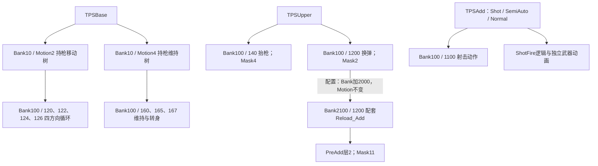

# ch0100（里昂）手枪动画拆分研究

日期：2026-11-04。范围：本机安装包的静态资源、动作树、状态机与角色配置；未进行游戏内逐帧回放。研究输出位于 E:/CodexPepo/RE_Research，未修改游戏资源。

## 1. 角色身份：ch0100 对应里昂

证据链：`cp_a000configuration.user.3` 的 `_LipSyncConfiguration._UseAssetTags` 为 `ch0100`，声音 `_SpeakerID` 也为 `ch0100`；`cp_a000montagepresetdata.user.3` 引用 `Character/ch/ch01/0100/ch0100_MontageData_*.user`。

外部交叉验证：RExtender 作者明确说明 `Cp_A000Updater` 对应 Leon，`Cp_A100Updater` 对应 Grace。[作者说明](https://www.nexusmods.com/residentevilrequiem/mods/2279?tab=description)

因此本次研究的 ch0100 主体资源可高置信度认定为里昂。cp_a000 同时引用其他外观编号，不能把所有 ch01xx 都理解为不同角色。

## 2. 拆分方式：动作片段、混合树、身体分层与武器变体

手枪行为由 TPSBase（移动和持枪基础姿态）、TPSUpper（抬枪、换弹等上身行为）、TPSAdd（射击相关行为）及 PreAdd 配置共同组织。源动作与运行时作用范围是两个概念：射击及换弹源 MOT 各含 67 条骨骼轨道，包括髋部和腿部，最终作用范围需要结合关节遮罩理解。

下面连线表示调用或配置关系，不表示固定的时间顺序。

### 动作树怎样组合移动与瞄准

- `Hold_strafe` 调用树 2：前、后、左、右四个 MotionNode 经 OctSyncBlendNode 混合，再进入 PlaySpeedNode。变量 `MoveDir` 控制方向；`MoveIntencity`（资源原拼写）经过范围归一化并与 `HoldStairMoveSpeed` 参与计算后控制速度。此处不臆测 Calculate 的 Operation 枚举运算含义。
- `Hold_Loop` 调用树 4：160 持枪循环与 165/167 左右转身循环混合，关联 `WheelBlendRate`、`WheelSpeed`。
- 上身 `HoldDefault / Normal` 调用树 5000，实际为含 JointMask9000 的 BasePoseNode。不能仅凭状态名称认定它重复播放 160。

### Bank 的定位必须包含 Type

|Type|BankID|所引用资源|
|---|---:|---|
|0|10|ch0100_MotionTree|
|1|0 / 2000|Handgun00M / Handgun00M_Add|
|1|100 / 2100|Handgun00H / Handgun00H_Add|
|0|100 / 2100|GeneralH / GeneralH_Add|
|65537、131073 等|100|Handgun00HverB、verC 等变体|

相同 MotionID 能在不同武器组或变体中复用；只用 BankID 或文件名猜调用对象会产生歧义。下表的手枪来源对应所选 Handgun00 组。

## 3. 手枪片段明细

frameCount / FPS 是源资源字段。运行时还受速度、混合、条件切换影响，不能直接当成游戏中持续时长。

|用途|Bank / Motion|源动作名|frameCount / FPS|调用入口与应用范围|
|---|---|---|---|---|
|瞄准移动-前|100 / 120|ch0100_Handgun00H_0120_Strafe_F_Loop|96 / 60|TPSBase → Bank10/Motion2；动作树节点 Mask0|
|瞄准移动-左|100 / 122|ch0100_Handgun00H_0122_Strafe_L_Loop|84 / 60|TPSBase → Bank10/Motion2；动作树节点 Mask0|
|瞄准移动-后|100 / 124|ch0100_Handgun00H_0124_Strafe_B_Loop|76 / 60|TPSBase → Bank10/Motion2；动作树节点 Mask0|
|瞄准移动-右|100 / 126|ch0100_Handgun00H_0126_Strafe_R_Loop|83 / 60|TPSBase → Bank10/Motion2；动作树节点 Mask0|
|抬枪进入|100 / 140|ch0100_Handgun00H_0140_Hold_Start_L0|30 / 60|TPSUpper → Wp0000H_140_Hold_Start_L0；Mask4：53个关节|
|持枪维持|100 / 160|ch0100_Handgun00H_0160_Hold_Loop|307 / 60|TPSBase → Bank10/Motion4；与165、167混合|
|持枪向左转|100 / 165|ch0100_Handgun00H_0165_Wheel_L_Loop|77 / 60|TPSBase → Bank10/Motion4；WheelBlendRate / WheelSpeed|
|持枪向右转|100 / 167|ch0100_Handgun00H_0167_Wheel_R_Loop|77 / 60|TPSBase → Bank10/Motion4；WheelBlendRate / WheelSpeed|
|放下枪|100 / 161|ch0100_Handgun00H_0161_Hold_End|109 / 60|TPSUpper → Hold_End分支；具体分支控制|
|单次射击|100 / 1100|ch0100_Handgun00H_1100_Shoot|30 / 60|TPSAdd → Shot/SemiAuto/Normal；附加状态机；精确层混合数学未复演|
|常规换弹主体|100 / 1200|ch0100_Handgun00H_1200_Reload|312 / 60|TPSUpper → Handgun00H_1200_Reload；Reload父节点 AutoSetJointMask2|
|常规换弹躯干补偿|2100 / 1200|ch0100_Handgun00H_1200_Reload_Add|312 / 60|UpperBodyPreAddConfiguration：层3 → 层2；Mask11：Hip 0.3，其余六关节0.5|
|另一换弹变体|100 / 1201|ch0100_Handgun00H_1201_Reload_All|194 / 60|TPSUpper → Handgun00H_1201_Reload_All；与1200分开制作，不强猜All枚举语义|
|换弹变体补偿|2100 / 1201|ch0100_Handgun00H_1201_Reload_All_Add|194 / 60|Bank偏移+2000 / Motion偏移0；Mask11|

## 4. 遮罩与换弹补偿：已找到显式配置

`cp_a000configuration` 的 `_UpperBodyPreAddConfiguration`：Enabled=true、UpperBodyLayerNo=3、PreAddLayerNo=2，引用 PlayerCommonPreAddSetting。

该设置的 DefaultBankIdOffset=2000、DefaultMotionIdOffset=0、DefaultJointMaskID=11。因此上身 `100/1200` 对应配套 `2100/1200`；两段均为 312 帧、60 FPS。1201 与其 Add 也同为 194 帧、60 FPS。配置支持成对组织主体动作与身体补偿的结论。

|Mask|关节数量|本次用途与范围|
|---|---:|---|
|2|51|Reload 父节点 AutoSetJointMask；包含手臂、手指、颈头及武器/目标等，不含脊柱及腿部；有一个骨名尚未解析|
|4|53|抬枪节点 SetJointMask；包含 Spine_0/1/2、手臂、手指及头部，不含腿部|
|11|7|PreAdd：Hip 权重0.3；Spine_0/1/2、Neck_0/1、Head_0 各0.5|

这里的权重为配置存值，不等于屏幕上最终混合权重。原始 mask 数值仍保留在 JSON；尚未完整验证每个标志位的引擎语义。TPSAdd 的名称和调用关系也不足以单独证明其精确叠加公式。

## 5. 状态切换与事件：已经定位到哪些内容

**抬枪**：`Wp0000H_140_Hold_Start_L0` 播放 `100/140` 并设置 Mask4；存在 CheckMotionEnd 检查。同时可按 `IsHoldStartShoot`（检查射击触发）转入 HoldStartShoot，也可按 `IsApplyGunHoldShort` 进入 ShortHoldMidTime。实际流程包含提前分支。

**射击**：TPSAdd 中 `Shot → SemiAuto → Normal → Handgun00H_1100_Shoot` 调用射击动作。Normal 父节点包含 `app.ShotFire`，并通过 `app.PlayEquipGunMotion` 请求武器自身 MotionID5000；上层还请求 Battle_ShotBefore / Battle_ShotAfter。动作退出关联 UpdateShootEnd 与 ConditionNodeWorkEnd。已证实射击动画、射击逻辑、武器动画分别受控；尚未确定子弹生成的精确帧。

**换弹**：Reload 父节点设置 Mask2；Handgun 分支通过 ReloadType 条件选择 Once / EverySingle，所见枚举值为0/1。1200 节点调用角色动画及武器动画，按 AppIsMotionEnd 转向 ActionEnd。1201 名称含 Reload_All，但本报告不把命名或枚举强行等同于空仓/非空仓。弹匣插入、弹量更新的准确事件帧仍待运行时验证。

## 6. 复用与外部动作包规则

解析器按本地片段、外部 motpack 引用及 base 列表中相同 `(MotionID, Switch)` 逐级解析，并记录来源。外部槽位需检查 ReferenceSelector：本样本中 selector=0 且索引非负可与指定 motpack 对齐；selector=255 的正索引不能直接当成 motpack 下标。

|列表|槽位|本地|继承|外部包|未解析|
|---|---:|---:|---:|---:|---:|
|Handgun00H|102|102|0|0|0|
|Handgun00M|274|247|27|0|0|
|Handgun30H|102|0|70|32|0|

例如 Handgun30H 继承 Handgun00H，并引用 Handgun30H_Common motpack；1200 的外部索引0落到 Handgun30H_1200_Reload。这说明武器变体可复用基础动作，仅替换差异动作。该 selector 规则来自结构交叉检查，不能视作全部 RE Engine 版本的正式格式规范。

## 7. 验证范围、证据与复现

- 有效样本862个资源：按相同资源路径取最高补丁编号建立静态视图，未通过运行时加载日志确认优先级。
- 310个 motlist、6个 motpack，累计23717个槽位；槽位包含继承和重复引用，不能当作独立动画数。
- 536个 user / motfsm2 输入全部解析成功；9个状态机的节点与转场字段通过两套解析路径交叉检查；112棵动作树完成类型化解析。这些检查确认解析一致性，不能代替引擎回放。
- 全部样本仍有106个特殊引用槽位未解析，明确保留未解析状态。所选 Handgun00H / Handgun00M 解析结果无未解析槽位。
- 部分 RE9 转场字段含义仍不确定；本报告没有据此宣称精确过渡时长、完整根运动规则或运行时混合公式。

关键文件（均在本报告目录）：

- `handgun_production_breakdown.csv`：14项片段、源帧数、调用入口和源文件。
- `handgun_evidence.json`：选中的状态机节点、父子层级、动作树、角色与 PreAdd 配置、骨骼遮罩。
- `all_resolved.csv` / `external_pack_mapping.csv`：槽位解析和外部包映射。
- `effective_files.csv` / `evidence_manifest.csv`：补丁来源与关键证据 SHA256。
- `validation.csv` / `full_parse_log.json`：交叉检查及解析记录。
- `full/` 与 `parsed/`：类型化结果和独立二进制解析结果。

脚本位于 `E:/CodexPepo/RE_Research/scripts`。核心流程为 ResearchPhase2.cs 选择性提取 → phase2_strings.ps1 有效版本 → deep_audit.ps1 二进制结构 → FullAudit/FullAudit.csproj 类型化解析 → phase2_finalize.ps1 解析引用 → phase2_deliverables.ps1 汇总。旧 handgun_resolved.csv 为早期继承结果，最终判断以 all_resolved.csv 为准。

工具来源：[REE.PAK.Tool](https://github.com/Ekey/REE.PAK.Tool)、[ReExtractor](https://github.com/PieceMetal/ReExtractor)；本地 RE-Engine-Lib 做了 .NET8 编译兼容调整，补丁保存在 `reelib_net8_compat.patch`。资源类型模板来自 REasy 与 REE-Lib-Resources，已存入 references 目录。

下一步最有价值的验证是记录一次游戏内里昂手枪抬枪、移动、射击、换弹时的 Bank/Type/Motion、状态与层权重，将实际切换和事件帧对回本报告。当前产物已可用于了解素材拆分和制作粒度；还不能替代逐帧动画播放或导出结果。
