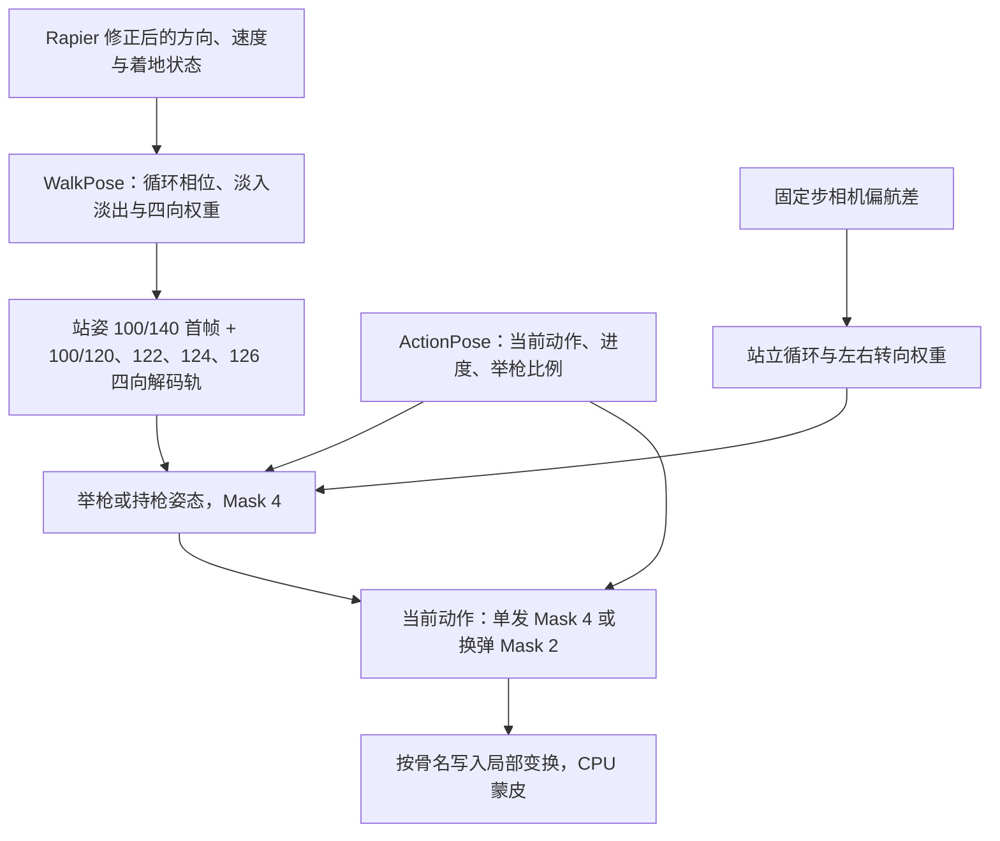

# Web 3C 技术文档

本文描述当前仓库的可运行实现，覆盖试玩、角色姿态回读和路线回放。启动方法见 [项目 README](README.md)，M0–M8 的原始目标与任务拆分见 [技术方案](../reports/web_3c_implementation_plan_zh.md)。

## 1. 入口与运行时

| 入口 | 用途 | 实现 |
| --- | --- | --- |
| [试玩场](index.html) | 两房一廊的完整操作路线，含越肩瞄准、单发命中、换弹和门交互。测试场可选择角色外观。 | [main.ts](src/main.ts) |
| [动作姿态回读](m2.html) | 检查原创 GLB 的绑定姿态、骨骼动作、单发叠加和换弹接触帧。 | [m2-pose.ts](src/m2-pose.ts) |
| [路线回放与调参](m7.html) | 用固定输入重跑正式关卡，查看角色、镜头、门和事件。支持单步、重置和导出。 | [m7-panel.ts](src/m7-panel.ts) |

试玩与回放都通过 `createTestRoom` 装配 Rapier 查询、移动、动作、镜头、门和靶。两者使用第 1 版数据契约、`test-room@1`、`ClipManifest` v1 和 `FeelConfig` v3。键鼠和回放文件各自实现同一个 `sampleInput` 接口。[运行时装配](src/level.ts) · [共享类型](src/contracts.ts) · [当前参数](src/feel.json)

### 固定步与渲染

- 模拟每步为 `1/60 s`。步号从 1 开始，事件时间为 `tick × STEP_S`，同一步的 `order` 从 0 开始。浏览器帧循环最多追赶 250 ms，页面可见性变化时重置帧时钟。[固定步循环](src/simulation.ts)
- 输入快照消费一次鼠标增量及开火、换弹、交互的按下边沿，持续按键保留至释放。失焦、解锁和页面可见性变化时清空输入。[输入缓冲](src/input.ts)
- 世界单位为米，+Y 向上，偏航零点朝 −Z。移动读取上一步的镜头偏航和瞄准状态，通过 Rapier 胶囊查询得出实际脚底位移、速度与着地状态。渲染插值角色位置、朝向和前移相位，镜头使用当步已提交的机位。[移动控制](src/movement.ts) · [场景查询](src/preview-scene.ts) · [渲染入口](src/main.ts)

## 2. 动作状态与角色显示

这一节以试玩场的**里昂灰模**为主。用分层图查看姿态合成顺序，用下方矩阵查询某个姿态和移动方向组合后实际用到什么资源。代码里，`actions.ts` 在每个固定步决定动作是否生效，并输出 `ActionPose`。渲染时，`leon-view.ts` 读取其中的方向步态、举枪比例和动作进度，按骨骼合成姿态。[固定步动作](src/actions.ts) · [里昂姿态合成](src/leon-view.ts)

### 2.1 里昂姿态的合成顺序

方向和动作可以同时变化。例如，移动中开火会继续计算脚步，再对符合遮罩的关节混入单发。关节缺少当前层轨道时保留已有姿态，采样缺少的平移、旋转或缩放通道时使用骨骼绑定值。位置和缩放做线性插值，旋转使用四元数球面插值。[姿态采样](src/leon-view.ts) · [动画数学](../docs/player/math.js)

### 2.2 姿态与方向调用矩阵

表中方向按**碰撞后的速度在角色局部坐标中的投影**判断。正常无阻挡时，W 前移、A/D 左右侧移、S 后退。W+A、W+D、S+A、S+D 是斜移。遇到墙时，实际滑动方向仍参与步态计算。松键或完全受阻后相位冻结，步态约 0.13 s 淡出。[移动控制](src/movement.ts) · [方向步态](src/actions.ts)

| 姿态 | 站立或停止后的底层 | 正前移 W | 侧移 A/D、后退 S、斜移 | 叠加与优先级 |
| --- | --- | --- | --- | --- |
| **普通低枪** `ready` | `100/140` 首帧。 | 从站姿淡入 `100/120` 全身步态，髋、脊柱和肩臂随脚步变化。 | 髋与腿取对应方向解码轨，脊柱补偿骨盆旋转以保留低枪上身。 | 举枪比例为 0，底层姿态直接送入蒙皮。 |
| **举枪** `raising` | 站姿叠加 `100/140` 的当前取样帧。 | `100/120` 保持推进，随举枪进度增加上身层权重。 | 方向步态继续计算，在其上混入举枪。 | `100/140` 按举枪比例从头向后采样，Mask 4。 |
| **稳定瞄准** `aiming` | 站姿上叠 `100/160` 持枪循环，原地转向混入 `100/165` 或 `100/167`。 | `100/120` 继续驱动髋和腿，Mask 4 覆盖的关节取 `100/160` 首帧。 | 四向轨驱动髋和腿，Mask 4 稳定上身握姿。 | 脊柱入口补偿骨盆旋转。站立层随移动步态淡入淡出。 |
| **单发** `firing` | 站姿和当前瞄准姿态继续取样。 | 全身前移相位继续推进。 | 方向轨继续采样。 | `100/1100` 的增量按 Mask 4 叠到当前持枪姿态，开火前后保留站立循环相位。 |
| **换弹** `reloading` | 按当前举枪比例保留低枪或瞄准姿态。 | 全身前移相位继续推进。 | 方向轨继续采样。 | `100/1200` 以绝对姿态按 Mask 2 混入，动作首尾各 10% 用于淡入淡出。 |
| **收枪** `lowering` | 从当前上身姿态向站姿过渡。 | `100/120` 继续，举枪层随进度撤回。 | 脚步继续，举枪层随进度撤回。 | 随 `lift` 下降反向取样 `100/140`，沿用 Mask 4；到 0 时撤掉举枪层。 |

Mask 4 和 Mask 2 取自播放器的遮罩数据。Mask 4 含脊柱、肩臂、手和武器挂点等关节，Mask 2 包含换弹所用的肩臂、手和挂点等关节。代码按骨名取权重，实际骨骼混合权重为「该层权重 × 遮罩权重」。瞄准层先合成，单发或换弹层最后合成。原作精确层权重仍待实测。[遮罩源数据](../docs/player/masks.js) · [骨骼混合](src/leon-view.ts)

### 2.3 步态如何取样

- **纯方向**直接采样对应解码循环的髋和腿。前、左、后、右分别用 `100/120`、`100/122`、`100/124`、`100/126`。每条轨的水平根位移标定该方向的步频，角色在关卡中的位移由 Rapier 提交。
- **斜向**把实际局部前后、横向速度除以相应源轨每循环的根位移，再归一化为混合权重。四条轨的左右脚落地分别对齐到共同相位的 0 和 0.5。换方向时权重短暂交叉淡化，相位连续推进。渲染使用同一比例插值角色位置、步态相位和方向权重。
- **起停**在 `100/140` 站姿和当前解码步态之间淡化。松开移动键或完全受墙阻挡时，相位冻结，保留当前方向权重约 0.13 s 后回到站姿。低枪、举枪、收枪沿用同一套下半身动作。源轨的髋、膝和落脚姿态直接参与混合，过渡时脚趾可随原姿态移动。

[步态状态计算](src/actions.ts) · [源轨距离和相位](src/leon-locomotion.ts) · [渲染插值](src/main.ts) · [前移和方向步态验收](../reports/web-3c/leon-playfield.md)

### 2.4 里昂动作资源清单

试玩直接加载 `MOTION_DATA`、`MODEL_DATA`、`MASK_DATA` 和共享蒙皮实现。下表用 Bank／Motion 标识轨道，名称省略共同前缀 `ch0100_Handgun00H_`。时长是**源素材长度**。[运行时轨道](../docs/player/motions.js) · [资产审计](../reports/web-3c/asset-audit.json) · [数据载入](src/leon-assets.ts)

| Bank／Motion | 资源名后缀 | 源时长 | 网页里的调用 |
| --- | --- | ---: | --- |
| `100/120` | `0120_Strafe_F_Loop` | 1.60 s | 正前移的全身循环，按距离取样。 |
| `100/140` | `0140_Hold_Start_L0` | 0.50 s | 第 0 帧作站姿，举枪按进度前向取样，收枪随 `lift` 下降反向取样。 |
| `100/160` | `0160_Hold_Loop` | 5.12 s | 站立瞄准逐步推进循环，移动瞄准取首帧。 |
| `100/165`、`100/167` | `0165_Wheel_L_Loop`、`0167_Wheel_R_Loop` | 各 1.28 s | 原地向左／右转时混入上身姿态，根骨骼旋转由角色朝向统一控制。 |
| `100/1100` | `1100_Shoot` | 0.50 s | 局部平移和旋转增量用 Mask 4 叠在当前持枪姿态。 |
| `100/1200` | `1200_Reload` | 5.20 s | 按换弹进度取样绝对姿态，使用 Mask 2。 |
| `100/122`、`100/124`、`100/126` | `0122_Strafe_L_Loop`、`0124_Strafe_B_Loop`、`0126_Strafe_R_Loop` | 1.40／1.27／1.38 s | 左、后、右循环，为对应方向及其斜向混合提供髋和腿姿态。 |
| `100/161`、`2100/1200` | `0161_Hold_End`、`1200_Reload_Add` | 1.82／5.20 s | 收枪与换弹附加轨的研究对照。试玩分别用举枪反向取样和换弹主轨。 |

站立瞄准的相位在 60 Hz 固定步推进。左右偏航差取跨 ±π 的最短有符号角，按 75 ms 时间常数低通。低于约 6.3°/s 时保留持枪循环，从该速度到约 24.6°/s 平滑混到相应转向轨。停转后同一滤波将权重衰减到零。渲染插值相位和权重。单发按「当前平移 + 增量平移」和「当前四元数 × 增量四元数」合成，使用 `100/160` 首帧时逐骨复现旧固定基准。原作射击基准、换弹附加层与方向动作树的精确运行时权重仍需实机验证。[站立瞄准与复现](../reports/web-3c/action-rules.md#里昂站立瞄准与转向) · [原作 3C 静态研究](../reports/3c/leon_tps_handgun_3c_zh.md)

### 2.5 玩法时序、参考时间轴和原创外观

`ActionState` 决定请求接受、动作切换和弹量，`ActionPose` 提供渲染进度。默认清单下，从低枪开始完整举枪在接受后第 27 步完成，举枪期间可缓存一次单发请求。举枪完成后可接受单发，单发接受后第 4 步依次发布开火与扣弹，场景随后计算命中。换弹接受后第 44 步补弹，从低枪或瞄准都可进入。里昂用已提交的归一化进度采样各自的源轨，因此源换弹轨的 5.20 s 与网页动作清单的 1.40 s 分别表示素材长度和玩法时长。[动作时序与打断条件](../reports/web-3c/action-rules.md)

原创外观加载 `m2-rehearsal.glb`。低枪取 `HoldIdle` 首帧，举枪和收枪采样 `Raise`，稳定瞄准取其末端，`Fire` 以 `Raise` 的 0.44 s 姿态为基准并限制到双臂六根骨，`Reload` 播放烘焙姿态并按混合权重减弱腿摆。各移动方向使用同一套程序化腿摆，由实际速度驱动。GLB 无法载入时显示胶囊。两种外观共用模拟根节点、碰撞、动作事件和弹量，完整路线测试覆盖切换后的结果。[动画清单](public/assets/clips.json) · [原创角色视图](src/action-view.ts) · [外观切换](src/player-view.ts) · [双外观路线测试](tests/leon-route.test.ts)

## 3. 镜头、准星与场景交互

普通与瞄准机位各有距离、肩偏移、高度和垂直 FOV。当前配置为 58°／46°。水平跟随、高度、举枪构图切换和离墙恢复分别阻尼，收到鼠标增量的固定步直接更新偏航和俯仰。机位目标使用平滑后的跟随位置，球扫从角色实时锚点出发。贴墙时优先满足净空，对过渡机位再扫一次，擦墙时的小幅回弹由恢复余量抑制。[镜头实现](src/camera.ts) · [镜头改前改后](../reports/web-3c/camera-tune-comparison.md)

动作阶段确认开火后，场景阶段用当步 `CameraPose` 的屏幕中心射线确定首次命中。命中练习靶时接在 `weapon.fired` 和 `ammo.committed` 后发布 `target.hit`，并点亮靶面。门交互在动作阶段更新门板显示和碰撞，角色占据门槛时拒绝关门。HUD 读取已提交的弹量和场景事件。[场景交互](src/level.ts) · [HUD](src/hud.ts) · [完整路线用例](tests/m6.test.ts)

## 4. 回放、配置与验收

`ReplayTrace` 记录契约版本、步长、关卡与参数版本、逐步输入和有序事件。当前基线覆盖 **616 步、31 条事件**，走完整条试玩路线后弹匣 8 发、备用 15 发。回放验证契约、步长、关卡版本及输入步号的连续性。重置会关闭门并复位碰撞，清理靶面反馈，重新初始化移动、镜头、动作和回放时钟。[回放实现](src/m7-replay.ts) · [基线](fixtures/route.replay.json) · [重置与确定性验证](../reports/web-3c/m7-handoff.md)

调参从 `FeelConfig` 的运动、镜头、动作三个分组开始。回放面板应用修改后会生成会话版本并从出生点重跑。分享调参结果时一起保留参数 JSON 与路线 JSON。修改默认配置时递增配置版本，用现有固定输入重录基线，并核对事件差异是否符合改动预期。[调参面板](src/m7-panel.ts) · [基线录制器](tests/record-m7-route.ts) · [固定输入](tests/test-room-route.mjs)

| 改动 | 验证入口 |
| --- | --- |
| 输入、碰撞、镜头避障或准星 | `npm.cmd --prefix web-3c test`。重点检查门框、台阶、L 角、贴墙举枪和命中投影。[镜头用例](tests/m4.test.ts) · [比较用例](tests/camera-tune.test.ts) |
| 动作时序、全身步态或灰模切换 | 运行全量测试，再用生产构建执行里昂与 M5 浏览器验收，检查起停脚滑、双手握姿、开火与补弹顺序。[里昂路线测试](tests/leon-route.test.ts) · [里昂浏览器测试](tests/check-leon-browser.mjs) · [M5 浏览器测试](tests/check-m5-browser.mjs) |
| 正式路线或默认参数 | 在仓库根运行 `node web-3c/tests/record-m7-route.ts` 重录，再跑全量测试。核对模拟 60／120 Hz 和连续重置后的逐步状态与事件。[M7 回归](tests/m7.test.ts) |

## 5. 构建、运行环境与实测范围

Vite 以相对资源路径构建三个页面到 `web-3c/dist/`。同步后的门户构建在 `docs/web-3c/`，研究首页的试玩链接由生成脚本维护。构建更新后核对发布目录与 `dist` 的文件清单和内容，并用普通 HTTP 服务验证子目录访问、门户往返和回放。[Vite 配置](vite.config.ts) · [门户生成脚本](../scripts/build_research_docs.cjs) · [静态验收](tests/check-m8-static.mjs)

- **本机 Vite**通过资源中间件读取仓库内的里昂灰模数据。[本机资源入口](reference-assets.ts)
- **同源门户**下，非本机主机名按相对路径读取门户的灰模资源。独立静态试玩包提供原创 GLB，资源缺失时可走完整条灰盒试玩和回放路线。[灰模加载](src/leon-assets.ts) · [发布验收与复现](../reports/web-3c/integration-check.md)

现有记录包含原创角色、里昂灰模和双窗同时运行的可见 Chromium 性能对比。在 RTX 3080、1440 × 1000 CSS 像素和 DPR 1 的记录环境中，三种配置的 p95 帧间隔均为 18.3 ms。外部托管链路待验证。T01–T10 的实机样本仍待采集，待校准项目包括输入接受窗口、换弹取消、最终镜头曲线和原作方向步态。[实测环境与数据](../reports/web-3c/integration-check.md#性能) · [实机采样表](../reports/web-3c/reference-timings.csv) · [步态范围](../reports/web-3c/leon-playfield.md)
